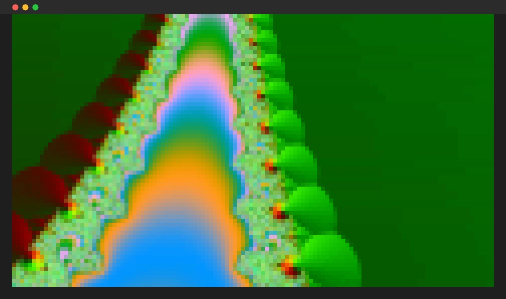
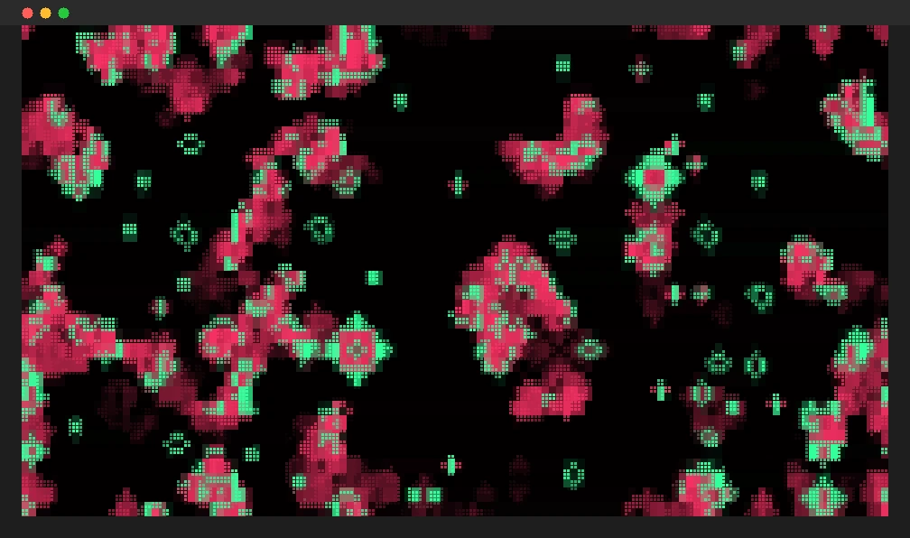
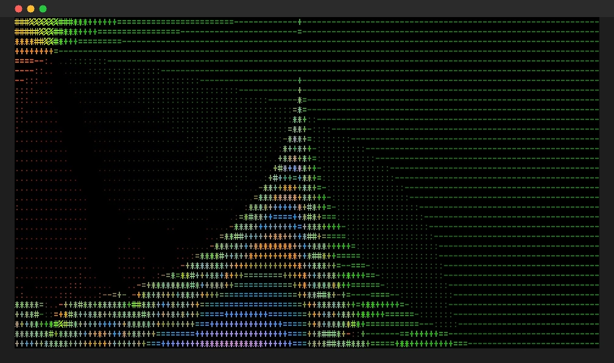
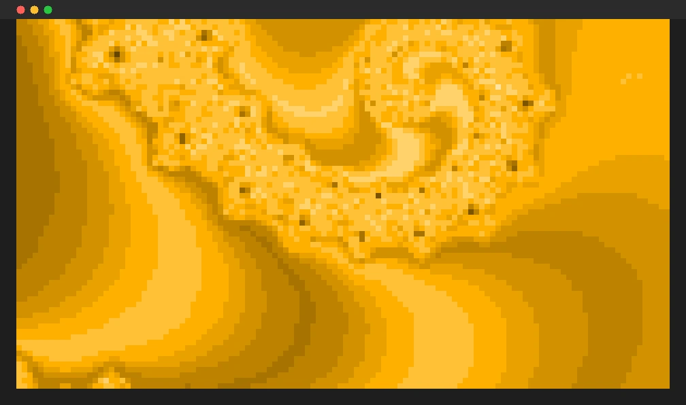

<div align="center">

# FrankenTTY

Streaming 30 FPS true-color video with sound through 50-year-old VT100 escape codes, right in your terminal.

[Install](#install) · [Releases](https://github.com/iant4093/FrankenTTY/releases) · [Build status](https://github.com/iant4093/FrankenTTY/actions) · [Report an issue](https://github.com/iant4093/FrankenTTY/issues)

[](#install)


[](https://github.com/iant4093/FrankenTTY/actions/workflows/ci.yml)
[](LICENSE)


</div>

---

FrankenTTY decodes video with FFmpeg and draws it with nothing but text. Each terminal cell holds two pixels: the upper half block `▀` takes the top pixel as its foreground color and the bottom pixel as its background color. An encoder keeps a model of what the screen already shows and writes only what changed. When the terminal still can't keep up, a quality governor trades color precision for frame rate. Sound plays through ffplay, and the video follows the audio clock.

## Screenshots

Frames rendered from FrankenTTY's real output at 120×34 cells: the encoder's bytes are replayed into a terminal emulator core (`@xterm/headless`), and its cell buffer is drawn at 8×16 px per cell. Regenerate with `node scripts/render-screenshots.ts`.

<table>
  <tr>
    <td width="50%" valign="top">
      
      <p align="center"><sub><b>Half-block</b> · two 24-bit pixels per cell</sub></p>
    </td>
    <td width="50%" valign="top">
      
      <p align="center"><sub><b>Braille</b> · eight dots per cell</sub></p>
    </td>
  </tr>
  <tr>
    <td width="50%" valign="top">
      
      <p align="center"><sub><b>ASCII</b> · luminance ramp, works without Unicode</sub></p>
    </td>
    <td width="50%" valign="top">
      
      <p align="center"><sub><b>Amber VT100</b> · one of four CRT palettes</sub></p>
    </td>
  </tr>
</table>

## Features

**Playback**

- Local video files and finite http(s) URLs, decoded by FFmpeg
- Audio through one long-lived ffplay fed paced PCM, with video locked to the audio clock
- Pause, seek ±5 s and ±30 s, loop; seeks land in about 0.2 s on files
- `--demo` plays five procedural FFmpeg sources (no media file, no copyright), with a seekable cache built in the background

**Rendering**

- 24-bit half-block, luminance ASCII and 2×4 Braille modes, switchable live
- TrueColor, 1978 amber, green phosphor and 4-shade handheld palettes
- Screen-model deltas, color-code reuse, combined SGRs, solid-cell spaces and a color-merge threshold
- Adaptive quality: merge colors, then 256 colors, then fewer cells, and back up when the terminal has room
- Live HUD with position, fps, KB/s, color codes saved and quality level

**Terminal support**

- Detects color depth, synchronized output and cell shape at startup
- 24-bit → 256 → 16 colors; ASCII-only when the locale is not UTF-8
- Restores the terminal on every exit path, including Ctrl+C, signals and crashes

## Install

```bash
# macOS and Linux
curl -fsSL https://github.com/iant4093/FrankenTTY/releases/latest/download/install.sh | sh
```

```powershell
# Windows (PowerShell)
irm https://github.com/iant4093/FrankenTTY/releases/latest/download/install.ps1 | iex
```

Then run `frankentty --demo`.

The installer picks the build for your OS and CPU, checks it against `SHA256SUMS` from the same release, and installs one file to `~/.local/bin` (Windows: `%LOCALAPPDATA%\Programs\FrankenTTY`). It never uses `sudo` for itself. FrankenTTY needs FFmpeg (`ffmpeg`, `ffprobe`, and `ffplay` for sound). If they're missing, the installer prints the command for your package manager and asks before running it. Uninstall by deleting that one file.

Release binaries are unsigned (macOS builds are ad-hoc signed), so Windows SmartScreen may warn on first run. Each release lists checksums and build provenance.

## Usage

```bash
frankentty movie.mp4
frankentty --demo life --mode braille
frankentty --demo gradients --palette amber
frankentty https://example.com/clip.mp4 --color 256 --no-audio
frankentty --bench --demo mandelbrot --size 120x35        # headless measurement
```

| Key | Action |
|---|---|
| `Space` | Pause / resume |
| `←` / `→` | Seek −5 s / +5 s |
| `Shift` + `←` / `→` | Seek −30 s / +30 s |
| `m` | Mode: half-block → ASCII → Braille |
| `c` | Palette: TrueColor → Amber → Green → DMG |
| `i` | Toggle HUD |
| `q` / `Ctrl+C` | Quit |

Useful options: `--fps`, `--threshold 0` (lossless colors), `--quality max` (turn the governor off), `--av-offset MS` (tune sound sync for your speakers), `--loop`. Run `frankentty --help` for the full list.

## Terminal support

| Tier | Terminals |
|---|---|
| 1 · hand-tested | Apple Terminal (macOS 26+) |
| 2 · CI on every push | Windows Terminal, Linux terminals (binary, installer and PTY tests); iTerm2, Ghostty, WezTerm, kitty, Alacritty, VS Code, GNOME Terminal, Konsole, tmux 3.4+ by capability detection |
| 3 · fallback | Older Apple Terminal (256 colors), Windows conhost, Linux console (16 colors, ASCII) |

## How it works

```text
ffprobe ─► media info
ffmpeg ─► rgb24 frames (2c × 4r) ─► mode cells ─► palette ─► encoder ─► stdout
            ▲ seek / resize                       (half-block,   (screen model, deltas,
            │                                      ASCII, Braille) RLE, threshold, 24/8/4-bit)
ffmpeg ─► PCM ─► pump (120 ms ahead) ─► ffplay        ▲
                    └──── audio clock ──── pacing ────┘ ◄── quality governor (write time)
```

This is the Frankenstein part. A modern codec pipeline feeds a 1978 text protocol, and the protocol was never meant to carry video. Apple Terminal accepts about 2.2–2.5 MB/s, and its real cost is the number of color sequences, not bytes ([evidence](docs/EVIDENCE.md)). So the encoder works to send fewer color codes. At 120×35 with default settings it sends 52–94% fewer color codes than a naive two-codes-per-cell encoder, and 16–89% fewer bytes, depending on the content.

| Demo | Color codes saved | Bytes saved |
|---|---|---|
| mandelbrot | 75% | 57% |
| life | 68% | 39% |
| cellauto | 52% | 16% |
| gradients | 84% | 77% |
| testsrc2 | 94% | 89% |

Measured with `bash scripts/bench.sh` on 2026-11-05; raw data in `docs/evidence/wave3/`.

## Tech stack

| Area | Technologies |
|---|---|
| Runtime | Node.js 24+ (26 LTS), TypeScript 6 in strict mode, zero runtime npm dependencies |
| Media | FFmpeg / ffprobe / ffplay over argv-only child processes; lavfi procedural demos |
| Terminal | VT100/ECMA-48 SGR, DEC synchronized output, DECRQM and window-size probes |
| Quality | Vitest, fast-check property tests, `@xterm/headless` emulator replay, PTY tests, ESLint, CodeQL |
| Delivery | GitHub Actions, Node single executable applications for 5 targets, SHA-256 checksums, build provenance, npm |

## Build locally

Requires Node 24+ (26 LTS recommended) and FFmpeg.

```bash
npm ci
npm run dev -- --demo
npm run bundle                              # dist/frankentty.cjs
bash scripts/build-release.sh --targets host  # single executable for this machine
```

`build-release.sh` uses official Node binaries, because Homebrew's Node has single-executable support turned off.

## Tests

```bash
# Typecheck, lint, unit, property-based, integration and PTY tests
bash scripts/test.sh

# Encoder sweep across demos, sizes, thresholds and color depths
bash scripts/bench.sh
```

Terminal behavior is tested by running FrankenTTY in a pseudo-terminal and replaying its output into a real terminal emulator core (`@xterm/headless`). Property tests cover geometry, frame assembly, the encoder round trip, palettes, the key router, the HUD, the clock, the audio pump and the quality governor.

## CI and releases

Pull requests and pushes to `main` run:

1. Hackathon compliance check, actionlint, shellcheck, zizmor and Gitleaks.
2. CodeQL for workflows and TypeScript.
3. Typecheck, ESLint and the full test suite on macOS, Linux and Windows.
4. Release build of all five single executables, then a smoke run of each on its own OS and CPU.
5. Installer tests (`install.sh`, `install.ps1`) against the built release on three OSes.

When all gates pass on `main` and `package.json` has a new version, CI publishes the GitHub release with checksums and provenance, and publishes to npm through trusted publishing. GitHub Actions are pinned to commit SHAs and Dependabot checks them weekly.

## Built with Kiro

FrankenTTY is built with a two-agent Kiro crew. `architect-opus` (Claude Opus 5.5) writes the specs, steering and task briefs and reviews every change. `builder-sonnet` (Claude Sonnet 5.5) implements each brief with tests. Independent tasks run in parallel builder sessions, one git worktree each. Hooks run tests after every write, block a turn until the suite is green, and refuse commits that would break submission rules. A Kiro Power (`powers/vt100-video/`) bundles an MCP server that lets an agent benchmark the encoder and see a rendered frame without a terminal. See [`.kiro/`](.kiro), [`docs/briefs/`](docs/briefs) and [`DEVPOST_WRITEUP.md`](DEVPOST_WRITEUP.md).

## Repository layout

```text
.
├── src/          CLI, ingest, audio, renderer, terminal, TUI, player and bench modules
├── tests/        Unit, property-based, integration and PTY tests
├── scripts/      Test, bench, release build, installers, demo media and Kiro hook scripts
├── tools/        MCP server for the vt100-video Power (dev tooling, not shipped)
├── powers/       Kiro Power: skills and MCP config
├── docs/         Plan, gap analysis, evidence log, task briefs, screenshots
├── spikes/       Throwaway feasibility experiments
├── .kiro/        Agents, steering, hooks and specs
├── .github/      CI/release workflow and Dependabot
└── README.md
```

## License

[MIT](LICENSE) © Ian Truong
